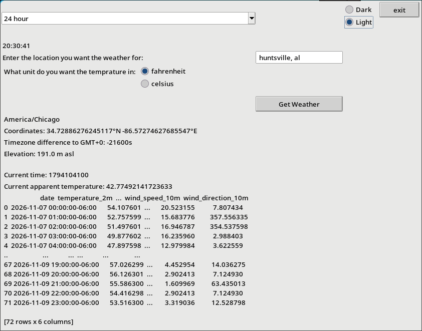
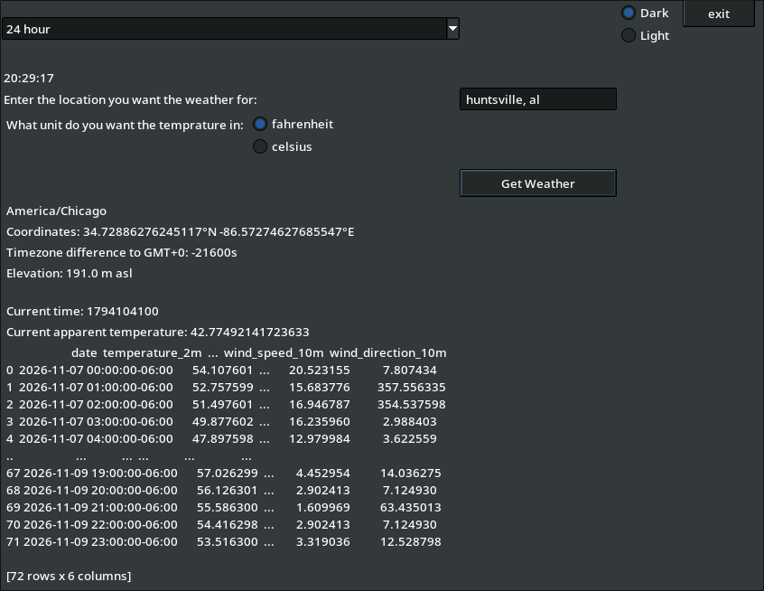

# Clock-app
A Clock, calender, and weather app writen in python
## Installation
### Recomended
Download the release for your system from the [latest release](https://github.com/dragonruler1000/Clock-app/releases/latest). You might have to mark it as executible and run it via the terminal (i have no idea why this is the case).
### From source
Clone the repo, make a venv, install the requirements and run the app using python
```
git clone https://github.com/dragonruler1000/Clock-app.git | cd Clock-app
python -m venv .venv | source .venv/bin/activate
pip -r requirements.txt
python gui-main.py
```
## Features
- View the current time in 15 diffrent formats (13 unique formats)
- see the current temp
- see the location (latitude, longitude, and elevation)
- see the forcast of the next 3 days with temprature, precipitation, windspeed and direction.
- light mode and dark mode
## Screen shots

